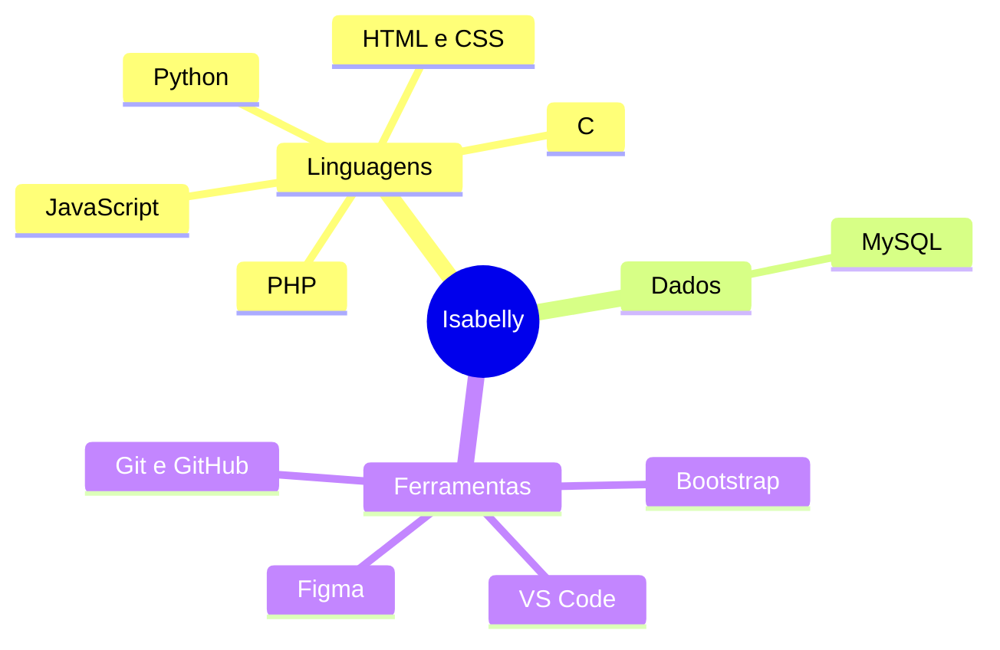

 

  

<!-- Menu de navegação: cada botão leva direto para a seção -->

---

## Sobre mim

Olá! Eu sou a **Isabelly França**!

- Graduanda em **Ciência da Computação na UNICID**.
- Técnica em Desenvolvimento de Sistemas pela ETEC Parque Belém.
- Jovem Aprendiz na área de Tecnologia do **Nubank**.
- Atualmente aprofundando meus conhecimentos em programação, banco de dados e desenvolvimento de software.
- Gosto de unir criatividade, tecnologia e resolução de problemas.
- Sempre aprendendo, explorando e desenvolvendo novos projetos!

 

<b>Clique aqui: sobre o que podemos conversar?</b>

 

| Assunto | Por quê |
|---|---|
| **Python** | Uso em automações e APIs, como no Bot de Estoque |
| **Banco de dados (MySQL)** | Modelagem e gestão de dados, como no Mercadão Pet |
| **Desenvolvimento web** | HTML, CSS, JavaScript e PHP nos meus projetos |
| **Começar em tecnologia** | Minha experiência como Jovem Aprendiz e estudante de Computação |

<a href="#user-content-topo">Voltar ao topo</a>

---

## Tecnologias e ferramentas

> Clique em qualquer ícone para abrir a documentação oficial.

**Linguagens de programação**

  

**Ferramentas e tecnologias**

 

<b>Clique para ver meu mapa de tecnologias</b>

<a href="#user-content-topo">Voltar ao topo</a>

---

## Projetos em destaque

> Clique em cada projeto para expandir ou recolher os detalhes.

<b>Mercadão Pet</b> &nbsp; 

 

Projeto de **banco de dados** para gestão de pet shop.

<!-- TODO: quando o repositório estiver público, adicione aqui o link: [Ver repositório](https://github.com/Isabelly0007/NOME-DO-REPO) -->

<b>Bot de Estoque</b> &nbsp;    

 

**MVP de automação de estoque** com integração ao WhatsApp.

<!-- TODO: quando o repositório estiver público, adicione aqui o link: [Ver repositório](https://github.com/Isabelly0007/NOME-DO-REPO) -->

<b>Literatura Brasileira</b> &nbsp;    

 

Site com **conteúdos literários** voltados para vestibulares.

<!-- TODO: quando o repositório estiver público, adicione aqui o link: [Ver repositório](https://github.com/Isabelly0007/NOME-DO-REPO) -->

<b>Projeto RPG</b> &nbsp; 

 

**Experiência interativa** que transforma linguagens de programação em personagens.

<!-- TODO: quando o repositório estiver público, adicione aqui o link: [Ver repositório](https://github.com/Isabelly0007/NOME-DO-REPO) -->

 

<b>Meus repositórios públicos</b> (o "último commit" atualiza sozinho)

 

| Repositório | Linguagem | Atividade |
|---|---|---|
| [**Hackathonicos**](https://github.com/Isabelly0007/Hackathonicos) — grupo participante do Hackathon |  |  |
| [**folio**](https://github.com/Isabelly0007/folio) |  |  |
| [**angatu**](https://github.com/Isabelly0007/angatu) |  |  |
| [**Python_Estudos**](https://github.com/Isabelly0007/Python_Estudos) |  |  |
| [**Imperio_Romano**](https://github.com/Isabelly0007/Imperio_Romano) | — |  |

*Confira meus repositórios para acompanhar os projetos e suas evoluções!*

<a href="#user-content-topo">Voltar ao topo</a>

---

## GitHub Analytics

<!-- Os cards mudam de cor sozinhos conforme o tema (claro/escuro) do visitante -->

<b>Minhas linguagens</b> (clique para recolher)

 

<picture>
  <source media="(prefers-color-scheme: dark)" srcset="https://github-profile-summary-cards.vercel.app/api/cards/repos-per-language?username=Isabelly0007&theme=github_dark&bg_color=082137&border_color=14415F&title_color=33B5E2&text_color=D6EEF7&icon_color=33B5E2&chart_color=33B5E2&animation=load"/>
  
</picture>
<picture>
  <source media="(prefers-color-scheme: dark)" srcset="https://github-profile-summary-cards.vercel.app/api/cards/most-commit-language?username=Isabelly0007&theme=github_dark&bg_color=082137&border_color=14415F&title_color=33B5E2&text_color=D6EEF7&icon_color=33B5E2&chart_color=33B5E2&animation=load"/>
  
</picture>

<b>Estatísticas e sequência de contribuições</b>

 

<picture>
  <source media="(prefers-color-scheme: dark)" srcset="https://github-profile-summary-cards.vercel.app/api/cards/stats?username=Isabelly0007&theme=github_dark&bg_color=082137&border_color=14415F&title_color=33B5E2&text_color=D6EEF7&icon_color=33B5E2&chart_color=33B5E2&animation=load"/>
  
</picture>
<picture>
  <source media="(prefers-color-scheme: dark)" srcset="https://streak-stats.demolab.com/?user=Isabelly0007&background=082137&border=14415F&stroke=14415F&ring=33B5E2&fire=33B5E2&currStreakNum=EFFBF7&sideNums=EFFBF7&currStreakLabel=33B5E2&sideLabels=9ED8F0&dates=7FB8D4"/>
  
</picture>

<b>Em que horário eu mais programo?</b> (clique para descobrir)

 

<picture>
  <source media="(prefers-color-scheme: dark)" srcset="https://github-profile-summary-cards.vercel.app/api/cards/productive-time?username=Isabelly0007&theme=github_dark&bg_color=082137&border_color=14415F&title_color=33B5E2&text_color=D6EEF7&icon_color=33B5E2&chart_color=33B5E2&timeZone=America/Sao_Paulo&animation=load"/>
  
</picture>

### Minha atividade no GitHub

<!-- Para ativar a cobrinha: suba o arquivo .github/workflows/snake.yml neste repositório e rode o workflow uma vez (aba Actions). -->
<picture>
  <source media="(prefers-color-scheme: dark)" srcset="https://raw.githubusercontent.com/Isabelly0007/Isabelly0007/output/github-snake-dark.svg"/>
  
</picture>

<a href="#user-content-topo">Voltar ao topo</a>

---

## Onde me encontrar

<!-- TODO: troque pelo link do SEU perfil, ex.: https://www.linkedin.com/in/seu-usuario/ -->

  

Gostou de algum projeto? **Deixe uma estrela** no repositório, isso me motiva a continuar!

---

### Obrigada pela visita!

*"Great things are done by a series of small things brought together."* — Vincent van Gogh

 

<b>Clique para ver uma frase aleatória de dev</b>

 

<picture>
  <source media="(prefers-color-scheme: dark)" srcset="https://quotes-github-readme.vercel.app/api?type=horizontal&theme=dark&quoteColor=EFFBF7&authorColor=33B5E2&backgroundColor=082137&symbolColor=33B5E2"/>
  
</picture>

